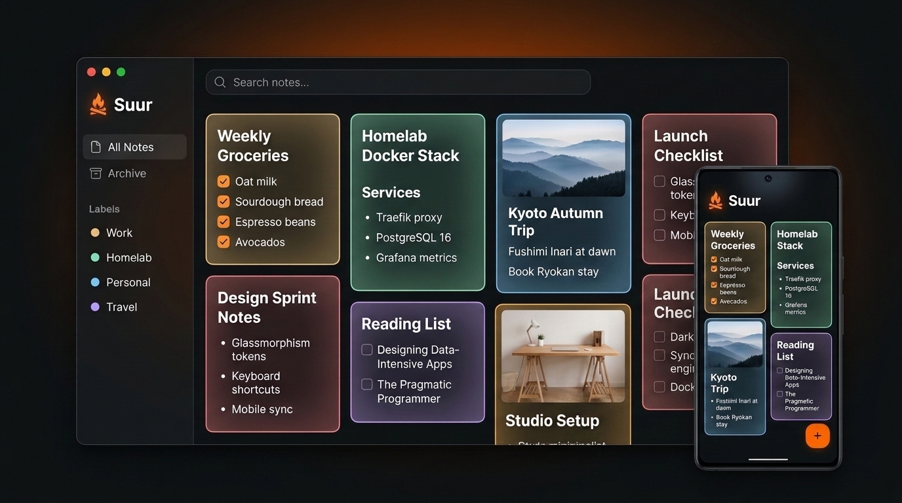

<div align="center">


# Suur

### The Fast, Private, Offline-First Self-Hosted Google Keep Alternative

**Capture thoughts, checklists, Markdown notes, voice memos, and files on your own server — with instant offline sync across Web, PWA, and Native Android.**

[](https://github.com/hng3444/suur/releases)
[](https://github.com/hng3444/suur/pkgs/container/suur)
[](#docker-image)
[](#persistent-data)
[](#casaos-installation)
[](LICENSE)

[Quick Start](#-quick-start-with-docker-compose) · [CasaOS Guide](#-casaos-installation) · [Why Suur?](#-why-suur--comparison) · [Features](#-complete-feature-overview) · [Android & PWA](#-pwa--native-android-client) · [Architecture](ARCHITECTURE.md)

<br />



</div>

---

## 🌟 What is Suur?

**Suur** is an open-source, self-hosted, offline-first note-taking platform engineered for people who love the speed and card-based simplicity of **Google Keep**, but refuse to compromise on **data ownership, offline reliability, Markdown support, and homelab simplicity**.

Packaged as a **single lightweight Docker container** (`linux/amd64` & `linux/arm64`) backed by **SQLite in WAL mode**, Suur deploys in under 30 seconds on any VPS, Raspberry Pi, Synology NAS, Unraid, Proxmox, or **CasaOS** home server — requiring **zero external databases** (no Postgres, no Redis, no separate API container).

When a new instance starts for the first time, Suur automatically seeds **3 interactive welcome & tutorial notes** so you can explore Markdown, checklists, labels, and shortcuts right away.

**Current release:** `v0.3.6`

---

## 📸 Product Tour & Screenshots

### Ember Glass Dark & Light Workspaces

<p align="center">
  
</p>

<table>
<tr>
<td width="50%" align="center">
<strong>Masonry Card Grid</strong><br><br>

</td>
<td width="50%" align="center">
<strong>Sidebar Navigation & Color Labels</strong><br><br>

</td>
</tr>

<tr>
<td width="50%" align="center">
<strong>Rich Note Editor & Attachments</strong><br><br>

</td>
<td width="50%" align="center">
<strong>Distraction-Free Read Mode & History</strong><br><br>

</td>
</tr>

<tr>
<td width="50%" align="center">
<strong>Interactive Checklists & PDFs</strong><br><br>

</td>
<td width="50%" align="center">
<strong>Appearance, Users & Backup Center</strong><br><br>

</td>
</tr>
</table>

---

## ⚡ Why Suur? (Comparison)

| Capability | **Suur** | Google Keep | Standard Self-Hosted Wikis |
| :--- | :---: | :---: | :---: |
| **100% Self-Hosted & Private** | ✅ Single Docker Container | ❌ Cloud-only | ✅ Often multi-container |
| **True Offline-First Editing** | ✅ IndexedDB Queue + Delta Sync | ⚠️ Limited browser cache | ❌ Usually online-only |
| **Conflict Copy Preservation** | ✅ Deterministic `(offline copy)` | ❌ Last-write overwrites | ⚠️ Varies |
| **Markdown + Live Preview** | ✅ Built-in safe Markdown | ❌ Plain text only | ✅ Yes |
| **100-Version Note History** | ✅ One-click point-in-time restore | ❌ No version history | ⚠️ Sometimes |
| **Voice Notes & Office Files** | ✅ Images, Audio, PDF, DOCX, XLSX | ⚠️ Images & basic audio | ✅ Yes |
| **Google Keep Takeout Import** | ✅ One-click ZIP/JSON importer | — | ❌ Rare |
| **Native Android + PWA Client** | ✅ Keystore Bearer + Snapshot/Delta | ✅ Proprietary | ⚠️ Web wrapper only |
| **Automated ZIP Backups** | ✅ Built-in daily/weekly scheduler | ❌ Manual Takeout | ❌ External cron needed |

---

## ✨ Complete Feature Overview

### 📝 Notes, Checklists & Organization
- **Instant Masonry Cards & List View:** Fast, responsive card grid or single-column list layout with drag-to-reorder pinning.
- **Interactive Checklists:** Press `Enter` to add items, `Backspace` to merge, and optionally auto-sink completed items to the bottom.
- **First-Class Markdown:** Write in plain text or toggle `</>` Markdown mode with headers, code blocks, blockquotes, task lists, and safe link rendering.
- **Color Palette & Custom Labels:** 7 curated card colors (`Default`, `Mint`, `Sage`, `Sand`, `Rose`, `Sky`, `Lavender`) and unlimited color-coded per-user labels.
- **Search & Multi-Faceted Filters:** Filter instantaneously by text, checklist items, label, card color, reminder status, or modification date (`Today`, `Last 7 days`, `Last 30 days`).
- **Built-in Onboarding:** Fresh installations come pre-loaded with 3 bilingual welcome and tutorial notes covering shortcuts, checklists, and backups.

### 🔄 True Offline-First Engine & Conflict Safety
- **Private Service Worker Shell:** Caches the authenticated app shell locally without leaking private API responses into shared HTTP caches.
- **Compacted Mutation Queue:** Rapid keystrokes, checklist toggles, label edits, and setting changes made offline are compacted in IndexedDB and replayed idempotently via `X-Suur-Mutation-Id`.
- **Zero-Data-Loss Conflict Resolution:** If two devices edit the same note version while offline, Suur never overwrites your work—it preserves the conflicting edit as a deterministic `(offline copy)` note.

### 📎 Rich Media & Voice Recording
- **In-Browser & Mobile Voice Recorder:** Record voice notes directly from the editor with live timer and automatic codec selection (`WebM`, `MP4/AAC`, `OGG`, `WAV`).
- **Drag-and-Drop Attachments:** Attach images (`JPEG`, `PNG`, `WebP`, `AVIF`, `GIF`), audio, `PDF`, text/Markdown, and Office/OpenDocument files (`DOCX`, `XLSX`, `PPTX`, `ODT`, `ODS`).

### 🤝 Multi-User Collaboration & Public Sharing
- **Shared Notes (User Assignment):** Assign any note to another user on your server for real-time collaborative editing while keeping label management, trashing, and permanent deletion strictly protected for the note owner.
- **Read-Only Public Links (`/s/[token]`):** Publish a revocable 128-bit unguessable link with automatic **OpenGraph social preview cards** and dark/light reader mode.
- **Role-Based Administration:** `superadmin`, `admin`, and `user` roles with per-user storage quotas (MB), profile avatars, and custom server branding (custom app name & `.ico` icon).

### 🛡️ Data Portability, Google Keep Migration & Automated Backups
- **1-Click Google Keep Importer:** Upload your Google Takeout `.zip` or `.json` archive—Suur imports notes, checklists, colors, labels, timestamps, and attached images while skipping duplicates via SHA-256 fingerprinting.
- **Portable Exports:** Export your entire workspace anytime as a full **Suur Backup ZIP** (with attachments), **JSON**, **Markdown ZIP** (`.md` per note), or **Plain-Text ZIP**.
- **Unattended Server Backups:** Built-in background maintenance scheduler automatically purges expired trash and creates daily or weekly server-side backups (retaining the latest 14 archives per user).

### 🌍 10 Languages Included (RTL & LTR)
English (`en`), Turkish (`tr`), Spanish (`es`), French (`fr`), Portuguese (`pt`), Russian (`ru`), Arabic (`ar` with full RTL layout), Chinese (`zh`), Hindi (`hi`), and Bengali (`bn`).

---

## 🚀 Quick Start with Docker Compose

### Option A: Run Prebuilt Image (Recommended — 30 Seconds)

Create a `compose.yml` file:

```yaml
services:
  suur:
    image: ghcr.io/hng3444/suur:latest
    container_name: suur
    restart: unless-stopped
    ports:
      - "3721:3000"
    environment:
      DATA_DIR: /data
      SUUR_PUBLIC_URL: http://localhost:3721
      MAX_UPLOAD_MB: "25"
    volumes:
      - suur-data:/data

volumes:
  suur-data:
```

Start the container:

```bash
docker compose up -d
```

Open **`http://SERVER_IP:3721`** in your browser.

### Option B: Clone & Build from Source

```bash
git clone https://github.com/hng3444/suur.git
cd suur
cp .env.example .env
docker compose up -d --build
```

### 🔐 Initial Superadmin Account

On a fresh database, Suur creates the initial administrator account and 3 welcome tutorial notes:

```text
Username: alaferoce
Password: 7Admin7
Role:     superadmin
```

> **Security Notice:** Suur enforces a mandatory password change on first login (**Settings → Profile**) before unlocking the rest of the API. You can customize `SUUR_DEFAULT_USERNAME` and `SUUR_DEFAULT_PASSWORD` in `.env` prior to first boot.

---

## 🏠 CasaOS Installation & One-Click Updates

### Method 1: Import CasaOS App Manifest
Import [`casaos/docker-compose.yml`](casaos/docker-compose.yml) directly in the CasaOS App Store (**Custom Install → Import**).

### Method 2: Manual CasaOS Setup
```text
Docker Image:   ghcr.io/hng3444/suur:latest
Container Port: 3000
Host Port:      3721
Host Volume:    /DATA/AppData/suur/data
Container Path: /data
Restart Policy: unless-stopped
```

### 🔄 How to Update Suur on Docker & CasaOS

- **CasaOS UI:** Click the three dots on the **Suur** app card and select **Update** (or **Update and Restart**). CasaOS pulls the latest `ghcr.io/hng3444/suur:latest` image while keeping `/DATA/AppData/suur/data` intact.
- **Docker Compose CLI:**
  ```bash
  docker compose pull
  docker compose up -d
  ```

Prebuilt multi-arch images (`linux/amd64` and `linux/arm64`) are available on GitHub Container Registry:
- `ghcr.io/hng3444/suur:latest`
- `ghcr.io/hng3444/suur:v0.3.6`

---

## 📱 PWA & Native Android Client

Suur is both an installable **Progressive Web App (PWA)** and a **Native Android Application** built with Capacitor.

- **Bundled Native UI:** The Android app ships its own instant, touch-first Ember Glass interface and connects to any self-hosted Suur server via `/api/mobile/server` discovery.
- **Hardware-Backed Security:** Uses 256-bit revocable bearer tokens stored in **Android Keystore** encrypted storage (never inside IndexedDB or web cookies).
- **Cursor-Based Delta Sync (`/api/mobile/sync`):** Downloads an initial snapshot once, then streams lightweight cursor deltas and deletion tombstones.
- **Offline Attachments & Native Reminders:** Caches viewed images, audio, and documents for offline access and schedules native Android local notifications for note reminders.

Build the Android Debug APK from source:

```bash
npm ci
npm run mobile:apk
```

Output path: `android/app/build/outputs/apk/debug/app-debug.apk`. Full protocol documentation is in [`docs/ANDROID.md`](docs/ANDROID.md).

---

## 🗄️ Persistent Data & Environment Variables

All state that must survive container upgrades lives inside a single `/data` mount:

```text
/data/
├── suur.db              # Primary SQLite database
├── suur.db-wal          # Write-Ahead Log for concurrent performance
├── suur.db-shm          # Shared-memory index
├── uploads/             # Note attachments, user avatars, and custom branding icons
└── backups/<user-id>/   # Automated and manual server backup ZIP archives
```

| Environment Variable | Default | Description |
| :--- | :--- | :--- |
| `SUUR_PORT` | `3721` | Host port mapped to container port `3000` |
| `SUUR_PUBLIC_URL` | `http://localhost:3721` | External URL (enables `Secure` cookies when `https://`) |
| `MAX_UPLOAD_MB` | `25` | Maximum size per uploaded attachment in MB |
| `SUUR_DEFAULT_USERNAME` | `alaferoce` | Initial superadmin username on first boot |
| `SUUR_DEFAULT_PASSWORD` | `7Admin7` | Initial superadmin password on first boot |
| `SUUR_FORCE_DEFAULT_PASSWORD_CHANGE` | `true` | Require changing the default password on first sign-in |
| `SUUR_MAINTENANCE_INTERVAL_MINUTES` | `60` | Background interval for trash cleanup & scheduled backups |
| `SUUR_TRUST_PROXY` | `false` | Trust reverse-proxy IP headers (`X-Forwarded-For`) for rate limiting |
| `SUUR_NOTE_HISTORY_LIMIT` | `100` | Number of historical versions retained per note (`10`–`1000`) |
| `SUUR_MAX_NOTES_PER_USER` | `50000` | Maximum note count per user (`1000`–`100000`) |

---

## 🔒 Security Architecture

- **Password & Token Cryptography:** Passwords hashed with `scrypt` (`N=16384, r=8, p=1`) + 128-bit random salt and verified with `timingSafeEqual`. Web & mobile session tokens and public share tokens are stored exclusively as **SHA-256 hashes**.
- **Brute-Force Protection:** Per-IP and per-username rate limiter with bounded memory protection.
- **Strict Isolation:** Content Security Policy (`CSP`), sandboxed attachment downloads (`default-src 'none'; sandbox`), `HttpOnly` + `SameSite=Strict` cookies, exact CORS origin allowlisting, and unprivileged container execution (`gosu node`, `no-new-privileges:true`).

See [`ARCHITECTURE.md`](ARCHITECTURE.md) and [`SECURITY.md`](SECURITY.md) for full details.

---

## 🛠️ Local Development

```bash
npm ci
npm run dev          # Start Next.js development server
npm test             # Run Node.js test suite (38 unit & sync tests)
npm run lint         # Run ESLint
npm run build        # Build standalone production Next.js server
npm run mobile:build # Build Capacitor mobile bundle
```

---

## 📦 Release History

```text
v0.1.1  Initial public release, bug fixes, and Docker foundation
v0.2.0  Multi-user accounts, sharing, and Google Keep import
v0.3.0  Offline mobile synchronization engine & cursor delta feed
v0.3.1  Mobile UX, navigation, draft recovery, and settings polish
v0.3.2  Back-layer navigation, vibrant theme, color picker, and motion polish
v0.3.3  Keep-style mobile chrome, unified note colors, and refreshed fire branding
v0.3.4  Unified Android/PWA icon scale, voice capture, and single-surface note scrolling
v0.3.5  Ember Glass visual system, refreshed motion, and unified web/mobile theme
v0.3.6  Web conflict-copy preservation, shared-note authorization, welcome tutorial notes, async ZIP engine, and Docker hardening
```

---

## 🤝 Contributing & License

Contributions, translations, and focused bug reports are welcome! Please read [`CONTRIBUTING.md`](CONTRIBUTING.md) before opening a pull request.

- **Author:** H. N. Güleroğlu (`hn9`) — [github.com/hng3444/suur](https://github.com/hng3444/suur)
- **License:** [MIT License](LICENSE)

---

<p align="center">
  <strong>Keywords:</strong> self-hosted notes · google keep alternative · offline-first notes app · docker notes · casaos app · homelab notes · sqlite pwa · markdown note taking · private cloud notes · open source keep alternative
</p>
